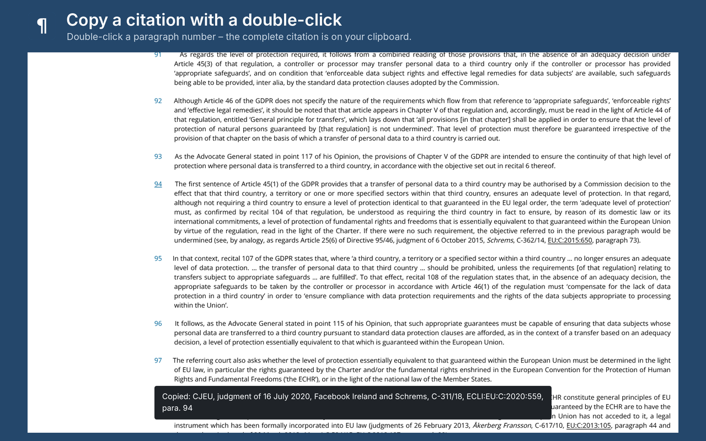
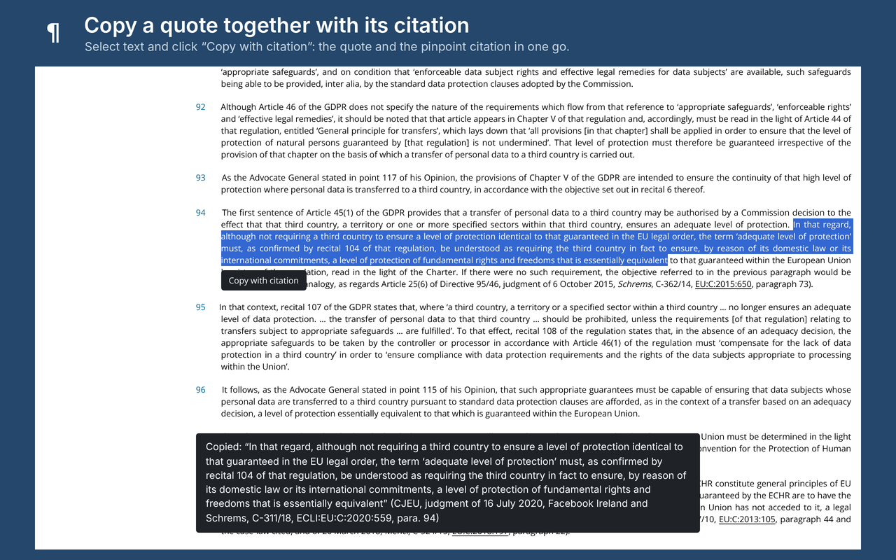
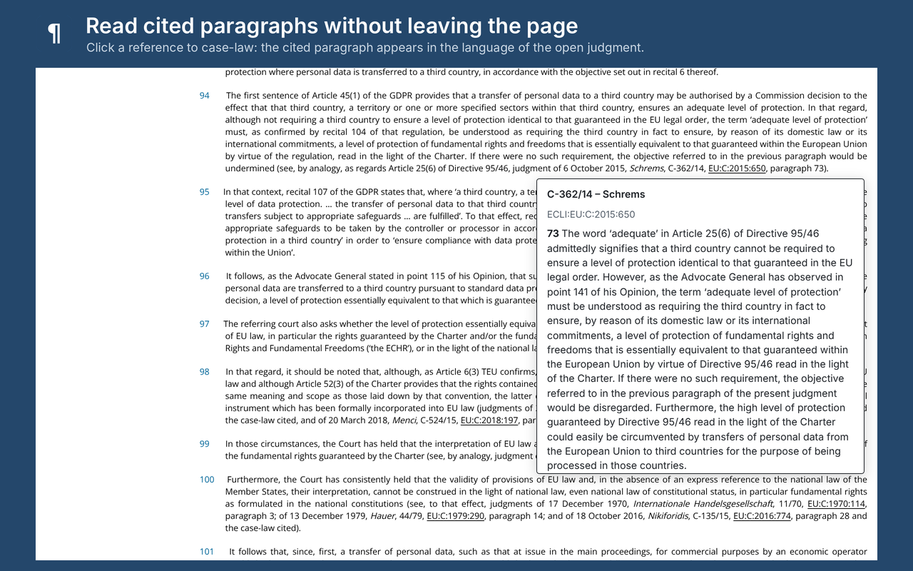
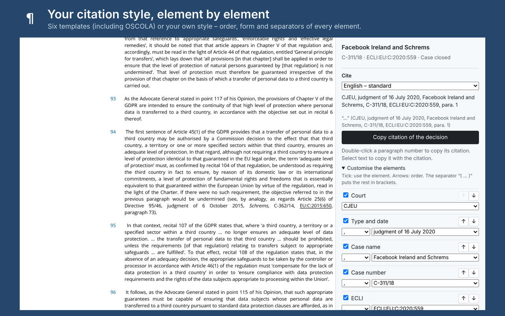
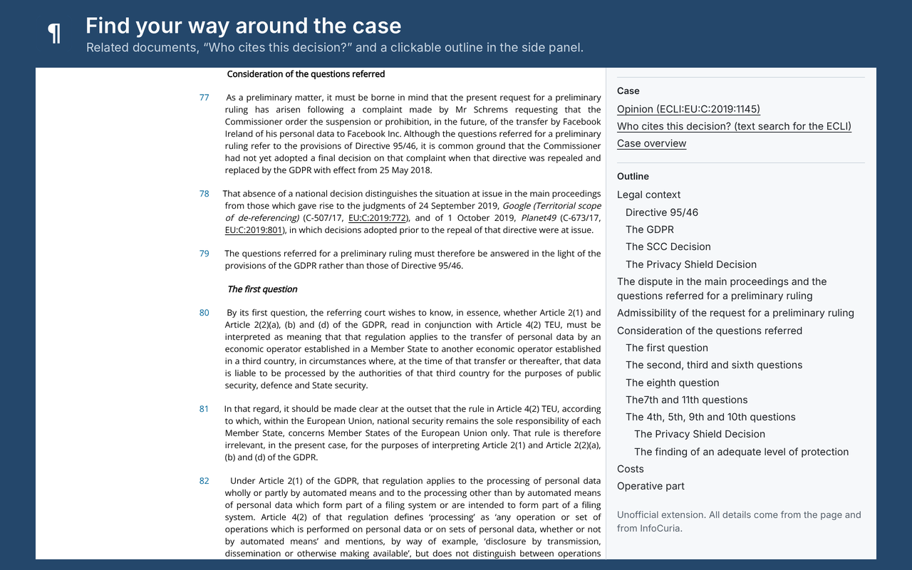

# Research tool for InfoCuria (unofficial)

A free Chrome extension for working with the case law of the Court of Justice and the General Court of the European Union in the Court’s [InfoCuria](https://juris.curia.europa.eu/juris/recherche.jsf?language=en) database.

[Deutsch](#deutsch) · [Privacy policy](PRIVACY.md)

> **Works only on the old InfoCuria website** ([juris.curia.europa.eu](https://juris.curia.europa.eu/juris/recherche.jsf?language=en)), not on the new InfoCuria (infocuria.curia.europa.eu). Open judgments there, e.g. via the [old search form](https://juris.curia.europa.eu/juris/recherche.jsf?language=en).

- **Citation by double-click**: double-click a paragraph number to copy the full citation, e.g.
  `CJEU, judgment of 16 July 2020, Facebook Ireland and Schrems, C-311/18, ECLI:EU:C:2020:559, para. 94`
- **Quote with citation**: select text and copy it together with its pinpoint citation.
- **References with preview**: decisions cited in the text become clickable. A pop-up shows the cited paragraph, in the language of the judgment you are reading, otherwise in English, otherwise in the language of the case.
- **Your citation style**: six templates (German, English, OSCOLA) or your own. You can switch each element on or off, reorder it, and change its form and separator.
- **Side panel**: the case, appeal and lower instance, further documents, “Who cites this decision?” and a clickable outline. It opens beside the page and never covers the text.
- **English or German interface.**

It works on judgments, orders, Opinions of the Court and Advocates General’s Opinions, in every language version that InfoCuria offers as text.

**Nothing is guessed.** Every element of a citation is read from InfoCuria: the case overview, the document itself and the case details. If an element cannot be read reliably, it is left out and the extension says so (“Incomplete: …”). Documents loaded in the background are checked for the right language and case number before they are used.

## Install

1. On this page, click the green **Code** button, then **Download ZIP**, and unzip the file.
2. Open `chrome://extensions` in Chrome (version 116 or later). Microsoft Edge (`edge://extensions`) supports the same extension interfaces but has not been tested.
3. Switch on **Developer mode** (top right).
4. Click **Load unpacked** and select the `extension` folder inside the unzipped folder (the one that contains `manifest.json`).
5. Pin the extension via the puzzle icon in the toolbar. Then open any judgment in InfoCuria and reload the page once.

To update, download the ZIP again, replace the folder and click the reload arrow on `chrome://extensions`.
Managed (company) browsers may block unpacked extensions. If so, ask your IT department.

## Privacy

The extension collects no data and sends nothing to third parties. It only loads public pages of InfoCuria. The citation style and interface language are stored locally in your browser. For the full text, see the [privacy policy](PRIVACY.md).

## Limitations

- This extension is unofficial and is not affiliated with the Court of Justice of the European Union. It relies on the existing InfoCuria interface (`juris.curia.europa.eu`). If the Court changes these pages, the extension may stop working until it is adapted.
- References are recognised by their ECLI.
- Please check citations before you use them.

For bug reports and suggestions, open an [issue](../../issues).

---

## Deutsch

Kostenlose Chrome-Erweiterung für die Arbeit mit der Rechtsprechung von EuGH und EuG in der Datenbank [InfoCuria](https://juris.curia.europa.eu/juris/recherche.jsf?language=de) des Gerichtshofs.

> **Funktioniert nur auf der alten InfoCuria-Website** ([juris.curia.europa.eu](https://juris.curia.europa.eu/juris/recherche.jsf?language=de)), nicht auf der neuen InfoCuria (infocuria.curia.europa.eu). Urteile dort öffnen, etwa über das [alte Suchformular](https://juris.curia.europa.eu/juris/recherche.jsf?language=de).

- **Fundstelle per Doppelklick**: Ein Doppelklick auf eine Randnummer kopiert die fertige Fundstelle, etwa
  `EuGH, Urteil vom 16. Juli 2020, Facebook Ireland und Schrems, C-311/18, ECLI:EU:C:2020:559, Rn. 94`
- **Zitat mit Fundstelle**: Markierten Text samt Fundstelle kopieren.
- **Verweise mit Vorschau**: Zitierte Entscheidungen werden anklickbar. Ein Fenster zeigt die zitierte Randnummer in der Sprache des geöffneten Urteils, sonst auf Englisch, sonst in der Verfahrenssprache.
- **Eigener Zitierstil**: sechs Vorlagen (Deutsch, Englisch, OSCOLA) oder ein eigener Stil. Jeden Baustein können Sie ein- und ausschalten, verschieben und in Form und Trenner ändern.
- **Seitenbereich**: Verfahren, Rechtsmittel und Vorinstanz, weitere Dokumente, „Wer zitiert diese Entscheidung?“ und eine anklickbare Gliederung. Er öffnet sich neben der Seite und verdeckt den Text nicht.
- **Oberfläche auf Deutsch oder Englisch.**

**Nichts wird geraten.** Jede Angabe stammt aus InfoCuria: aus der Verfahrensübersicht, dem Dokument und den „Detaillierten Angaben“. Lässt sich eine Angabe nicht sicher lesen, bleibt sie weg, und die Erweiterung meldet „Unvollständig: …“.

### Installieren

1. Auf dieser Seite auf den grünen Knopf **Code** und dann auf **Download ZIP** klicken und die Datei entpacken.
2. In Chrome (ab Version 116) `chrome://extensions` öffnen.
3. Oben rechts den **Entwicklermodus** einschalten.
4. **Entpackte Erweiterung laden** wählen und im entpackten Ordner den Unterordner `extension` auswählen, also den Ordner, in dem `manifest.json` liegt.
5. Die Erweiterung über das Puzzle-Symbol anheften, ein Urteil in InfoCuria öffnen und die Seite einmal neu laden.

In verwalteten Firmen-Browsern können entpackte Erweiterungen gesperrt sein. Dann hilft nur die IT.

### Datenschutz und Grenzen

Die Erweiterung erhebt keine Daten und sendet nichts an Dritte. Sie ruft nur öffentliche Seiten von InfoCuria ab. Zitierstil und Sprache werden lokal im Browser gespeichert ([Datenschutzerklärung](PRIVACY.md)). Sie ist inoffiziell und steht in keiner Verbindung zum Gerichtshof der Europäischen Union. Bitte prüfen Sie Fundstellen vor der Verwendung.

## License

[MIT](LICENSE)
